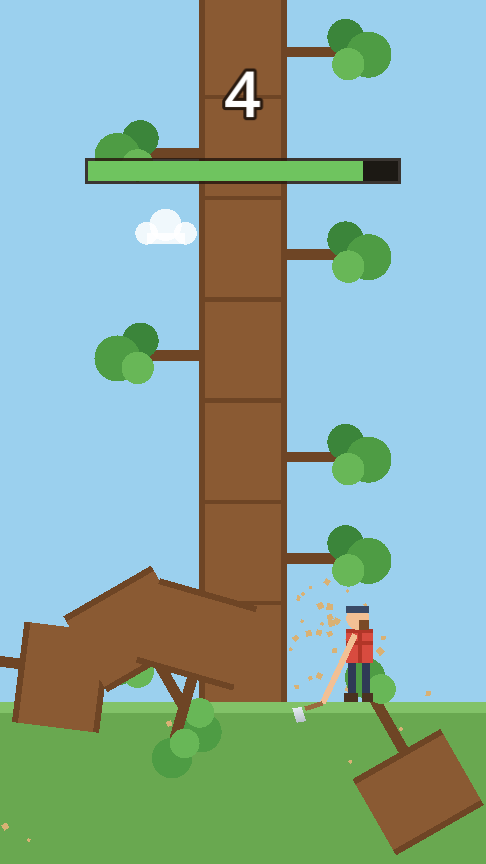
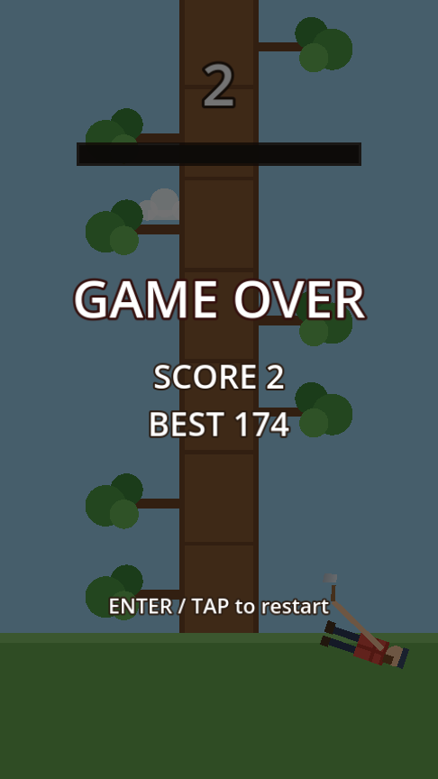
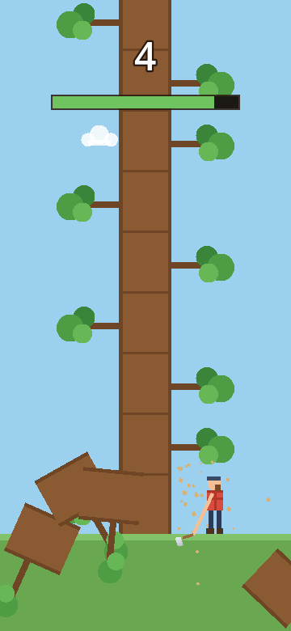

# Lumber Jack

A Timberman-style 2D reaction game built with **Godot 4.4** — no art assets, everything is drawn in code.

 

| Gameplay | Game over | Mobile (20:9) |
| --- | --- | --- |
|  |  |  |

## Gameplay

Chop the endless tree, one segment per press. Every segment grows a branch on the left or right — a correct chop is one taken from the side **without** a branch.

Losing is all about the clock:

- A time bar constantly drains (starts at 1.0s worth, caps at 2.0s).
- Each correct chop refills **+0.45s**; chopping into a branch earns nothing.
- The drain rate rises with your score, so eventually your reaction speed can't keep up.
- When the bar empties, the lumberjack drops. Best score is saved locally.

## Controls

| Action | Input |
| --- | --- |
| Chop left | `←` / `A` / tap left half |
| Chop right | `→` / `D` / tap right half |
| Restart | `Enter` / `Space` / tap |

## Run

Open the project in Godot 4.4+ and press play, or:

```sh
/Applications/Godot.app/Contents/MacOS/Godot --path .
```

Export presets for **Android** (APK) and **iOS** are included in `export_presets.cfg`.

## Tests

Headless rules check (win/lose/reward/reset logic):

```sh
Godot --headless --path . --script res://tests/rules_test.gd
```

## Project layout

```
scenes/main.tscn    scene + UI
scripts/main.gd     all game logic and code-drawn rendering
tests/rules_test.gd headless rules test
```
